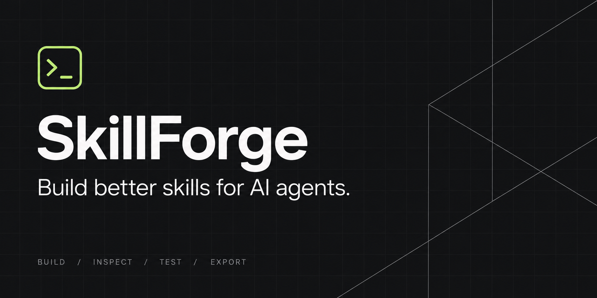
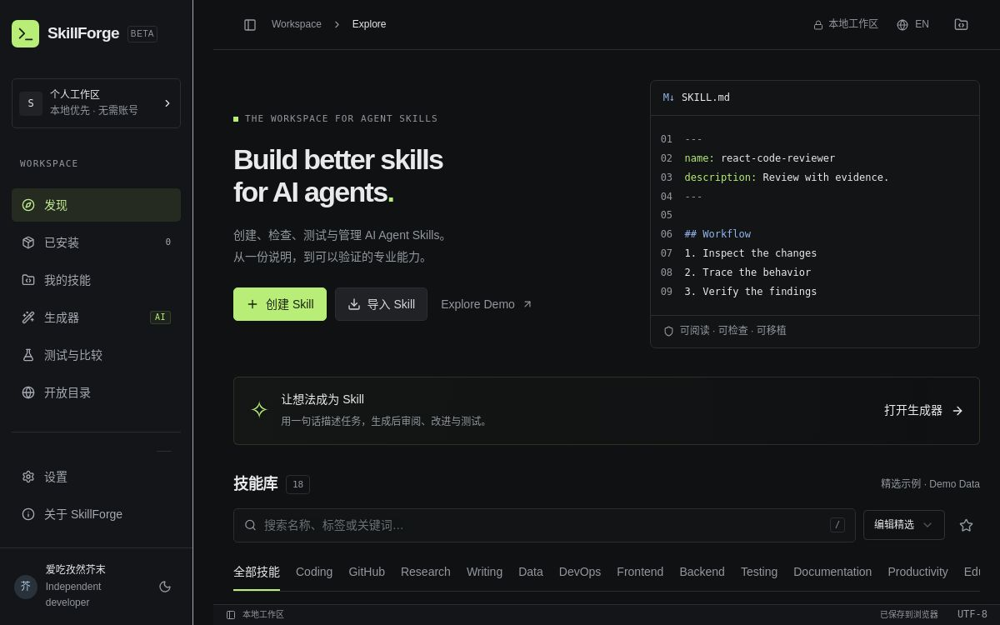

<div align="center">

# SkillForge

**Build, test, inspect and manage skills for AI agents.**

创建、测试、检查与管理 AI Agent Skills。


[](https://github.com/ZZZ234234234/SkillForge/releases)
[](https://github.com/ZZZ234234234/SkillForge/actions/workflows/ci.yml)

[Quick Start](#quick-start) · [Explore Demo](https://skillforge.honey-chick-7267.chatgpt.site/demo) · [Browse Skills](registry/registry.json) · [中文说明](#中文说明)

</div>



SkillForge is a local-first **Skill Manager** for developers building AI agents. Create a reusable playbook, inspect its structure and tool permissions, test its contracts, and export a portable package.

A prompt manager stores text. SkillForge connects that text to a typed schema, workflow, input/output contract, examples, tests, explainable quality checks, and platform export adapters.

| Build | Inspect | Iterate |
| --- | --- | --- |
| **Skill Builder** — forms and Markdown/JSON editing | **Skill Inspector** — actionable rules and secret detection | **Skill Tester** — rules, explicitly labeled mocks, optional LLM evaluation and real tool-calling runs |
| **Skill Generator** — offline templates or your configured AI model | **Quality Score** — nine dimensions with visible evidence | **Cross-platform export** — Codex Skills, Claude Code Skills and generic Agent Skills |
| **Agent Run** — execute one skill on a task and watch every tool call and approval | **Steward Agent** — search, read, create and update the library by conversation, with approval before each change | |

The bundled registry contains **18 original Demo Skills**, including React Code Reviewer, Next.js Bug Hunter, GitHub Release Manager, SQL Reviewer, Academic Research Assistant and API Security Checker. No downloads, stars, installs or benchmarks are invented.

## Quick Start

Requirements: Node.js 22.13+ and npm. The verified build wrapper requires Linux/WSL with GNU `timeout` and Bash. Windows users can use WSL. For a direct portable build, use `npm run build:portable`.

```bash
npm ci
npm run dev
```

Open the local address printed by Vite, then visit `/demo`. No account, API key or database is needed for the library, editor, inspector, offline generator, rule tests, comparison and export.

```bash
npm run typecheck
npm run lint
npm test
npm run build
npm run test:integration
```

The UI uses React, TypeScript, Tailwind and shadcn/ui, with Next.js App Router conventions compiled by **Vinext/Vite** for Cloudflare Workers. It is not a stock Next.js/Vercel build. Browser storage is abstracted behind `SkillStorage`; no cloud database is used.

## Demo

`/demo` is a separate browser workspace, seeded with 18 skills and clearly labeled **Demo Data**. `/` and `/workspace` share the normal local workspace. Demo edits survive reloads separately from normal work.

1. Open React Code Reviewer and inspect its intentional missing-error-handling warning.
2. Edit the error policy and see its heuristic score change.
3. Open Generator, choose an offline template and describe a task.
4. Review the output, add tests, save it and compare it against another skill.
5. Export ZIP, JSON, Markdown or a platform directory package.

The screenshot above shows the actual deployed site. Public access, search, editing, live scoring, offline generation, rule comparison, language/theme switching and saved browser data have been exercised in a real desktop browser. Download-file observation timed out even though the app reported a prepared file; ZIP encoding/import round-trip passed automated tests. Mobile/iPad visual checks, paid-model calls and GIF recording remain unverified. See [browser verification](docs/BROWSER_QA.md), [recording instructions](docs/DEMO_RECORDING.md) and [deployment instructions](docs/DEPLOY_DEMO.md).

## Features and boundaries

| Feature | v0.2.x behavior |
| --- | --- |
| Library | Search, categories, sorting, tags, favorites, local install state, copy, delete and export |
| Editor | Form/Code modes, basic safe Markdown preview, valid-code autosave, undo/redo, code search, JSON/Markdown formatting |
| Generator | Offline deterministic template mode; real Chat Completions-compatible request path; review, improve, simplify, strictness, tests, error handling and section regeneration |
| Inspector | Goal/role completeness, output contracts, tools, broad permissions, constraints, examples, tests, duplicate text, verbosity, limited vagueness/conflict rules and platform metadata |
| Quality | Clarity, Completeness, Tool Safety, Workflow, Error Handling, Testability, Portability, Maintainability, Documentation |
| Tests | Rule Evaluation, Mock Evaluation, optional LLM response + model judge, and Agent Evaluation (real tool calls); timestamp, status, duration, model, available tokens, real tool-call count, results and notes |
| Agent Run | Runs one skill on a task with a 12-step tool loop, attached material files, a per-tool permission table and a live trace; write and network tools ask first |
| Steward Agent | Library management by conversation (`search_skills`, `read_skill`, `create_skill`, `update_skill`); every create or update needs approval |
| Comparison | Multiple skills, one shared suite, current-run results; token data shown only when returned; tools execute only in Agent Evaluation |
| Import | Markdown, canonical JSON, folder and ZIP import; explicit public GitHub **file** URLs, subject to browser/network support |
| Export | Full ZIP package, SKILL.md, skill.json, README.md; Codex/Claude/Generic directories |
| Registry | Bundled open catalog, curated ordering, newest, categories, search; PR contribution format |
| Settings | Chinese/English interface, dark/light mode, endpoint/model settings and memory-only API key |
| Desktop app (v0.3.0, Windows x64) | Scans the skill folders of local agents (27 built-in folders, plus automatic discovery of others), installs into them, auto-refresh on folder changes, library stored as a local file; not code-signed |

In the browser, “Installed” means installed into the **browser library**, not into an agent or the operating system. The agent features run inside the browser with a small set of in-app tools: no shell, no local filesystem, no package installation. Reading and writing the skill folders on your computer is available in the **desktop app** (see below); a CLI and live community trending are **Coming Soon**. Skills authored in English remain English when the interface language changes.

### Desktop app

An Electron app for Windows x64 that works on the skill folders of this computer: it scans the folders of the agents you have installed, adds a skill from a folder to the library, installs a skill into any of those folders, and refreshes when a folder changes. Skills added from disk follow their file; if both the file and the library copy change, you choose which one to keep.

The folders of 27 agents are built in, each taken from the agent's documentation: Claude Code, Cursor, Codex, GitHub Copilot, OpenCode, Doubao, Gemini CLI, Antigravity, Windsurf, Kiro, Trae, Trae CLI, Qoder CLI, QoderWork, CodeBuddy Code, ZCode, Kimi Code CLI, Amp, iFlow CLI, Qwen Code, Cline, Roo Code, OpenHands and Devin. Other agents are **found automatically** by the shape of their skills folder (`<folder>/skills/<name>/SKILL.md`), or can be added with **Add folder**.

Files that are replaced or uninstalled go to the Recycle Bin, and files that SkillForge did not write are never touched. The library is stored in the app data folder. The app is **not code-signed**, so Windows shows a SmartScreen warning on first run.

Download the installer or the portable program from the [Releases page](https://github.com/ZZZ234234234/SkillForge/releases). To run it from source:

```bash
cd desktop && npm install && npm run build:ui && npm start
```

See the [desktop guide](docs/DESKTOP.md) for the scanned folders, how files are written, the sync rules and what was verified, and the [v0.3.0 release notes](docs/RELEASE-v0.3.0.md) for the downloads.

### Agent runtime and permissions

SkillForge now includes an **in-browser agent runtime**. It is a loop over your configured model: the model calls a tool, SkillForge decides whether the call may proceed, executes it, and returns the result to the model until the model gives a final answer or a limit is reached.

- **The skill's `permissions` text decides what runs automatically.** Read-only declarations run without asking. Anything that reads as write or network asks for confirmation on every call. A declaration that cannot be classified is treated as write, and a broad declaration (wildcards, “unrestricted”, “sudo”, “全部权限”) is confirmed even when it binds to a read-only tool.
- **Only tools the skill declares are bound.** A read-only declaration never binds to a write-capable tool. A declared tool with no in-browser equivalent (a shell, a database, an internal API) is shown as *not bound* and is never simulated; if the model still calls it, the trace records `unavailable`.
- **Available tools:** `list_files`, `read_file`, `search_skills`, `read_skill` (read), `web_fetch` (network, subject to CORS, 15 s timeout, 12k characters), `save_artifact` (write, kept inside the run and downloadable, 200 KB max) and, for the Steward Agent only, `create_skill` and `update_skill` (write, schema-validated, id and status cannot be set by the model).
- **Limits:** 12 model steps per run (10 for the Steward), up to 10 attached files of 2 MB each, a Stop button that aborts the request and refuses any approval still open, and a downloadable JSON record of every run.

### Honest evaluations

**Quality Score is heuristic and intended as a development aid.** Checks are transparent text/structure rules. A high score does not prove task quality, consistency or safety. Conflict checks recognize limited English patterns; they are not semantic verification.

- **Rule Evaluation** checks the Skill's role, goals, instructions, workflow, tool definitions, constraints, input/output formats, error handling and nonempty sections. Test assertions and example text are excluded from text matching. It does not execute the test input or judge real task behavior.
- **Mock Evaluation** replays an example and returns `skipped`, never an invented pass rate.
- **LLM Evaluation** sends the skill and input to your configured provider, then asks a model to judge its response. No tools execute. The judge may be wrong. Network time is included. Tokens are `N/A` when not reported.
- **Agent Evaluation** runs the skill as a real tool-calling agent (same runtime as Agent Run) and checks the `contains` / `notContains` / section assertions against the **real final output**. No model judge is used. It reports how many tool calls succeeded, were approved, were denied, were unavailable or failed. A run that stops is `error` and is not scored; a test without assertions is `skipped`. Tool calls are counted only when they succeeded. An example whose input equals the test input is left out of the prompt, because its output would be the expected answer.
- Comparison uses one selected suite for every selected skill. Rule timing is not an agent performance benchmark, and a passing Agent Evaluation only shows that one run on one input produced the asserted text.

### AI setup

Open Settings and enter a Chat Completions-compatible base URL, an actual model ID from the provider, and optionally a key. The application appends `/chat/completions`. It calls the provider directly from your browser, so the provider must allow CORS. HTTPS is required except for localhost. There is no server-side proxy.

The key remains only in React memory, is not saved to browser storage, and is not exported. Refreshing clears it. Generator and tester clearly disclose when an action sends content and may incur provider charges. Real-provider calls were **not exercised with paid credentials** during initial verification; transport and validation were tested with an isolated mock.

The agent features also need a model that returns OpenAI-style `tool_calls`. Provider support for tool calling varies; if the model never returns a tool call, the run ends with a plain answer and zero tool calls. The runtime was verified in a real desktop browser against a **scripted mock provider** (requests intercepted in the browser), not against a paid model, and `web_fetch` was verified with the same interception: real cross-origin behavior still depends on each site's CORS headers. See [browser verification](docs/BROWSER_QA.md).

## Skill package

```text
my-skill/
  SKILL.md
  skill.json
  README.md
  examples/examples.json
  tests/cases.json
  assets/
  LICENSE
```

`skill.json` is the full-fidelity SkillForge schema. `SKILL.md` uses readable YAML frontmatter and Markdown instructions. Importing arbitrary Markdown preserves its body; structured section extraction recognizes SkillForge's English headings. Unknown frontmatter remains in metadata. Arbitrary scripts, binary assets and nested external references are not installed or preserved as executable bundles by v0.1.0. Export the original package separately if those resources matter.

### Platform adapters

| Target | Output | Boundary |
| --- | --- | --- |
| Generic AI Agent | `<name>/SKILL.md` | Receiving agent must load instructions |
| Codex | `.agents/skills/<name>/SKILL.md` | Directory export; no automatic install or Codex execution |
| Claude Code | `.claude/skills/<name>/SKILL.md` | Directory export; no automatic install or Claude execution |
| OpenAI Agents SDK | Generic instruction bundle | **Experimental**, not an official SDK config |
| MCP-based Agents | Generic instruction bundle | **Experimental**, not an MCP server or protocol implementation |

MCP supplies tool connectivity; an Agent Skill supplies task instructions. SkillForge does not conflate the two. It is a Developer Tools project for Agentic AI workflows with a small in-browser runtime for exercising skills, not a hosted agent service or a general-purpose agent framework.

References: [Agent Skills specification](https://agentskills.io/specification), [Codex Skills](https://developers.openai.com/codex/skills), [Claude Code Skills](https://code.claude.com/docs/en/skills).

## Security & Authenticity

### Official Distribution & Authenticity

Official repository: **[ZZZ234234234/SkillForge](https://github.com/ZZZ234234234/SkillForge)**. The first official [v0.1.0 Release](https://github.com/ZZZ234234234/SkillForge/releases/tag/v0.1.0) was published successfully on 2026-09-07.

**Official releases are distributed only through this repository’s GitHub Releases page.** Third-party file-sharing sites are not official distribution channels. Names such as “SkillForge Official”, “SkillForge Pro” or “SkillForge Installer” do not establish authenticity. No official desktop installer exists in this version.

The release workflow packages source and web assets, produces `SHA256SUMS.txt`, and generates GitHub artifact attestations before publication. **v0.1.1 has a published [build provenance attestation](https://github.com/ZZZ234234234/SkillForge/attestations/45898209) covering both ZIP files**, confirmed in its [successful release workflow](https://github.com/ZZZ234234234/SkillForge/actions/runs/34200874592). **[v0.2.0](https://github.com/ZZZ234234234/SkillForge/releases/tag/v0.2.0) was published on 2026-11-26 by the same [workflow run](https://github.com/ZZZ234234234/SkillForge/actions/runs/45810315387)**; its attestation step succeeded, and the attestation record itself was not independently checked. **[v0.3.0](https://github.com/ZZZ234234234/SkillForge/releases/tag/v0.3.0) was published on 2026-11-26 by its [workflow run](https://github.com/ZZZ234234234/SkillForge/actions/runs/45831811270)**, which also built and attached the desktop installer and portable program after running the smoke checks on the packaged program; installing through the installer was not exercised. Verify the exact version and file you download; this is provenance, not a security audit.

For an artifact that actually appears in an official Release:

```bash
# Linux
sha256sum -c SHA256SUMS.txt
# macOS
shasum -a 256 -c SHA256SUMS.txt
# Windows: compare the printed digest with SHA256SUMS.txt
certutil -hashfile "SkillForge-v0.1.1-source.zip" SHA256
```

A checksum detects changed bytes; it does not independently prove who published them. Obtain checksums from the same verified official Release. If that Release has successfully generated attestations, verify the exact artifact:

```bash
gh attestation verify SkillForge-v0.1.1-source.zip --repo ZZZ234234234/SkillForge
```

An absent attestation is not a verified artifact. [GitHub provenance documentation](https://docs.github.com/actions/security-for-github-actions/using-artifact-attestations/using-artifact-attestations-to-establish-provenance-for-builds).

MIT allows forks, modification and redistribution. Forks are welcome; they do not become official releases. See [TRADEMARKS.md](TRADEMARKS.md) for factual identity boundaries and [SECURITY.md](SECURITY.md) for reporting.

### Local data and secrets

Skills and test history remain in this browser by default. Storage is unencrypted and origin-specific. Clearing browser data deletes it; export backups. The desktop app keeps the same data in files under its app data folder instead ([desktop guide](docs/DESKTOP.md)). Data is sent only when you request GitHub import or model generation/evaluation, and when you start an Agent Run, an Agent Evaluation or a Steward chat. Those send the skill, your task or message, attached material files and tool results to your provider. `web_fetch` contacts the requested site directly from your browser after you approve it. Do not place keys, passwords, cookies, tokens or Authorization headers in public skills.

Tool results, fetched pages and attached files are returned to the model as data. The system prompt tells the model to treat them as data rather than instructions, but prompt injection through fetched content is not fully preventable; review approvals and treat fetched text as untrusted.

Secret detection is pattern-based, has false positives and false negatives, and does not replace review. Detected values block model transmission and individual Skill export until redacted. Imports are untrusted, never executed. ZIP path traversal and expansion limits are checked before extraction (5 MB compressed, 10 MB expanded, 100 entries, 2 MB per entry).

## Contributing

Start with [CONTRIBUTING.md](CONTRIBUTING.md). To contribute a Skill, follow [CONTRIBUTING_SKILLS.md](CONTRIBUTING_SKILLS.md). See [architecture](docs/ARCHITECTURE.md), [changelog](CHANGELOG.md) and release notes ([v0.3.0](docs/RELEASE-v0.3.0.md), [v0.2.0](docs/RELEASE-v0.2.0.md), [v0.1.1](docs/RELEASE-v0.1.1.md)).

## Roadmap

- [x] v0.1: library, editor, inspector, scoring, demo, import/export
- [x] v0.1: offline generator, configurable AI request path, rule/mock test bench and shared-suite comparison
- [x] v0.1: bundled registry and contribution format
- [x] v0.2: in-browser agent runtime with permission gating, Agent Run, Steward Agent and Agent Evaluation
- [ ] v0.2: verified provider presets, richer semantic evaluations and editable assertion builder
- [ ] v0.2: community registry submission validation and real, attributable popularity data
- [x] desktop app (Electron, unreleased): scan local skill folders, install into them, refresh on change
- [ ] v0.3: direct Codex/Claude integrations, MCP tools and CLI
- [ ] v1.0: plugin system, signed installers and registry ecosystem

## Author

Created and maintained independently by **爱吃孜然芥末**.

Contact: **[2014546082@qq.com](mailto:2014546082@qq.com)**

If SkillForge helps you build better AI agents, consider giving it a ⭐.

## 中文说明

SkillForge 是一个本地优先的 AI Agent Skills 创建与管理工具。Skill 可以理解为“教 AI 专业完成一种任务的可复用工作说明书”。你可以用表单编辑它、检查结构和权限、运行规则测试、比较多个版本，再导出为可阅读的 Markdown 文档和程序可解析的 JSON 数据。

默认简体中文、深色界面，无需注册。演示功能不需要密钥。真实 AI 生成需要自行配置模型服务，内容将发送给你选择的服务商。离线模板不是 AI 生成，规则评分也不是绝对质量标准。

v0.2 新增两个入口：**Agent 试运行**选一个技能和任务，按技能的权限真实调用工具，每次调用和授权都记录在轨迹里；**管家 Agent**用对话检索、新建和修改技能库，改动前每次都要你确认。测试页新增 **Agent 评测**，对真实输出判定断言。Agent 只能使用浏览器内的少量工具，不能执行 shell，也不能改动你电脑上的文件。

另有一个**桌面版**（Electron，Windows，[v0.3.0 起在 Releases 提供](https://github.com/ZZZ234234234/SkillForge/releases)安装版和便携版）：直接扫描这台电脑上各 Agent 的技能文件夹（内置 27 个 Agent 的目录，其余按目录形状自动发现，也可手动添加），可以把技能安装进去，文件夹有变化会自动刷新；被覆盖或卸载的文件进回收站，不是 SkillForge 写入的文件不会动。桌面版没有代码签名，首次运行会出现 Windows SmartScreen 提示。详见[桌面版说明](docs/DESKTOP.md)（英文）。

作者：爱吃孜然芥末。邮箱：2014546082@qq.com。正式发行只认官方 GitHub Releases；源码 Fork 可以正常使用，但不代表作者官方发行。
